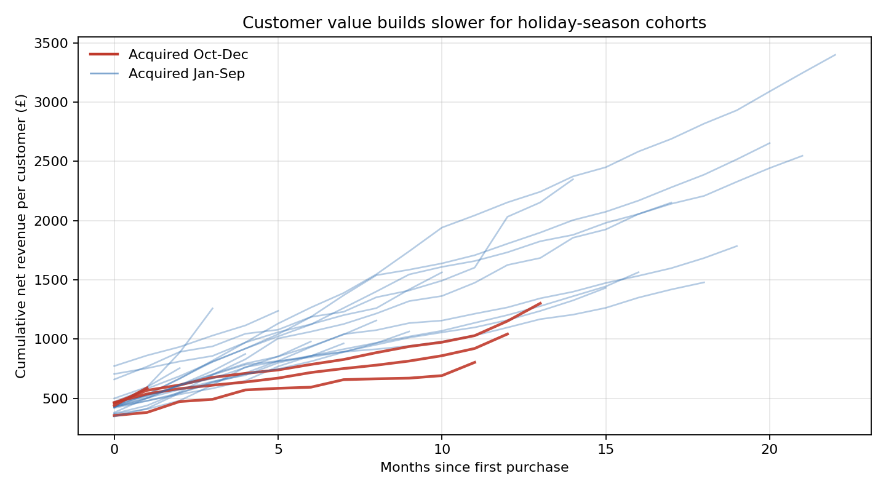
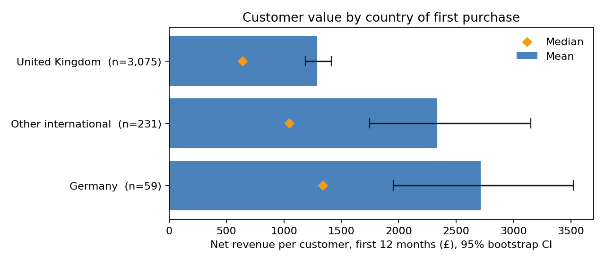
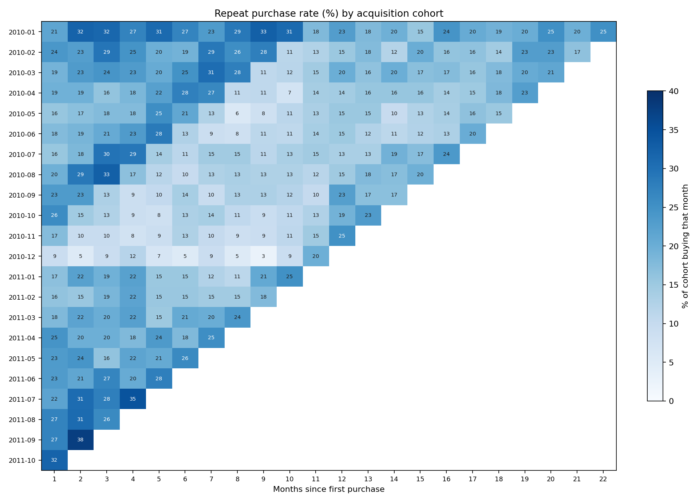

# Cohort Retention, LTV & CAC (DuckDB SQL + Python)

[](https://github.com/SylviaZam/GTM-Cohort-CAC-LTV/actions/workflows/tests.yml)

How much is a new customer worth, how quickly do they come back, and how much can you afford to spend to win one? This project answers those questions from raw order data. The cohort logic is written in SQL and runs in DuckDB, and the results are exported to an Excel workbook and charts. It runs on **real transactions** from a UK online gift retailer: the public [UCI Online Retail II](https://archive.ics.uci.edu/dataset/502/online+retail+ii) dataset, about 1 million order lines from Dec 2009 to Dec 2011. It also accepts any orders file, plus a marketing-spend file to compute CAC.

## What the data shows

The analysis covers 4,873 customers acquired from Jan 2010 to Nov 2011, in 23 monthly cohorts. Values are net revenue in GBP, after returns and before costs.

**1. Holiday-season customers are worth less.** Customers acquired in October-December spent **£962** in their first 12 months, against **£1,273** for customers acquired in April-September. The difference is -£311, with a 95% bootstrap interval of -£594 to -£70. Medians show the same gap: £472 vs £635. Every cohort's 12-month window covers each season once, so this comparison isn't distorted by seasonal shopping patterns. A promotion that wins many November customers brings in less value per customer than the headline numbers suggest.



**2. Customers outside the UK are worth about twice as much.** Customers whose first order came from Germany spent **£2,714** in their first 12 months (95% CI £1,955-£3,522, n = 59), against **£1,289** for UK customers (£1,189-£1,413, n = 3,075). Other international customers, pooled, spent £2,330. The UCI documentation notes that many of this retailer's customers are wholesalers. Bigger overseas accounts are a more likely explanation than country itself, so this is a lead to check by account type, not a market conclusion.



**3. Repeat buying sets the budget.** About 21% of a cohort buys again in the month after their first purchase, and 45% of first-year value arrives in the first three months. The table below shows the most the business could pay to acquire one customer and still break even, by payback window and gross margin:

| Break even within | Avg. value per customer | at 30% margin | at 40% margin | at 50% margin |
|---|---|---|---|---|
| 3 months | £643 | £193 | £257 | £322 |
| 6 months | £905 | £272 | £362 | £453 |
| 12 months | £1,385 | £416 | £554 | £693 |

The dataset has no marketing spend, so this table works backward from customer value to an affordable acquisition cost. With a spend file, the tool also computes actual blended CAC, LTV:CAC, and the month each cohort pays back (see below).



## How it works

1. **Clean the raw data** ([`sql/00_clean_lines.sql`](sql/00_clean_lines.sql), logged in [`data/cleaning_log.csv`](data/cleaning_log.csv)):

   | Step | Order lines remaining |
   |---|---|
   | Raw data | 1,067,371 |
   | Remove exact duplicates (the two yearly sheets overlap 1-9 Dec 2010) | 1,033,036 |
   | Remove guest checkouts (no customer ID) | 797,885 |
   | Remove fees, manual adjustments, tests, and gift vouchers | 796,667 |
   | Remove zero-price sales | 796,606 |

   The result is 44,254 invoices from 5,877 customers. Returns stay in as negative revenue.
2. **Build cohorts** ([`sql/cohorts.sql`](sql/cohorts.sql)): each customer's first purchase defines their cohort (a return doesn't count as a first purchase). From there the SQL builds monthly activity, a retention matrix, cumulative LTV, and customer-level value at 3, 6, and 12 months.
3. **Set a fair window:**
   - The first month of data (Dec 2009) is excluded, because "new" customers that month include people who had bought before the data starts.
   - The partial last month (1-9 Dec 2011) is ignored, so it doesn't look like churn.
   - Months a cohort hasn't reached yet are left blank, not filled with 0. Filling them with 0 would make young cohorts look worse.
4. **Measure uncertainty:** per-customer value is very skewed (a few large wholesale buyers), so tables report medians alongside means, with 5,000-draw bootstrap intervals that are reproducible with a fixed seed.
5. **CAC** ([`sql/cac.sql`](sql/cac.sql), only when a spend file is given): blended CAC = spend in the cohort month / customers acquired that month. The output adds LTV:CAC by month and the payback month.

## Limitations

- **Revenue, not profit.** Multiply by your gross margin. The table above shows 30-50%, because this retailer's margin isn't public.
- **Wholesale mixed with retail.** The dataset doesn't label account type, which drives the country gap and the skew.
- **One retailer, 2010-2011.** The patterns show how to read cohorts; they aren't benchmarks.
- **Early 2010 cohorts may still include some returning customers**, which inflates their value. That's why the holiday comparison uses April-September as its baseline.
- **Blended CAC only:** with a channel column in the spend file, the next step would be per-channel CAC.

## Run it

```bash
python -m venv .venv && source .venv/bin/activate
pip install -r requirements.txt

python -m src.cohort_cli                                  # UCI data (included, 450 KB)
python -m src.cohort_cli --orders my_orders.csv --spend my_spend.csv
```

- Orders file: `order_id, order_date, customer_id, revenue[, country]`, with returns as negative revenue.
- Spend file: `month (YYYY-MM), spend[, channel]`.
- Options: `--first-cohort`, `--last-month`, `--horizon`, `--min-customers`.

To rebuild `data/orders.csv.gz` from the raw UCI workbook, follow the steps in [`scripts/prepare_data.py`](scripts/prepare_data.py).

**Tests:** 12 tests run on hand-built order sets with known answers. They cover:
- cohorts assigned by first purchase, not by a return;
- returns netting against value;
- unreached months left blank;
- CAC and payback;
- every cleaning rule;
- the full command line, run on the real data.

Run them with `pip install -r requirements-dev.txt && python -m pytest -q`.

## Outputs

`reports/cohorts.xlsx` has these sheets: Readme, Cohort_summary, Retention, LTV_cumulative, By_country, Holiday_vs_midyear, Affordable_CAC, CAC (when spend is given), and Cleaning_log. The charts are in `assets/`.

## Repository layout

```
sql/00_clean_lines.sql     raw UCI lines -> one row per invoice
sql/cohorts.sql            cohorts, retention, cumulative LTV, customer-level value
sql/cac.sql                blended CAC, LTV:CAC, payback month (with spend data)
src/cohorts.py             runs the SQL in DuckDB; pivots, country table, bootstrap
src/report.py              Excel workbook and charts
src/cohort_cli.py          command-line entry point
scripts/prepare_data.py    rebuilds data/orders.csv.gz from the raw UCI file
data/                      cleaned orders (UCI Online Retail II, CC BY 4.0) and cleaning log
tests/                     pytest suite; fixtures include a small synthetic orders + spend set
```

Data: Chen, D. (2012). *Online Retail II* [Dataset]. UCI Machine Learning Repository, https://doi.org/10.24432/C5CG6D, licensed CC BY 4.0. Built by [Sylvia Zamora](https://sylviazamora.com).
